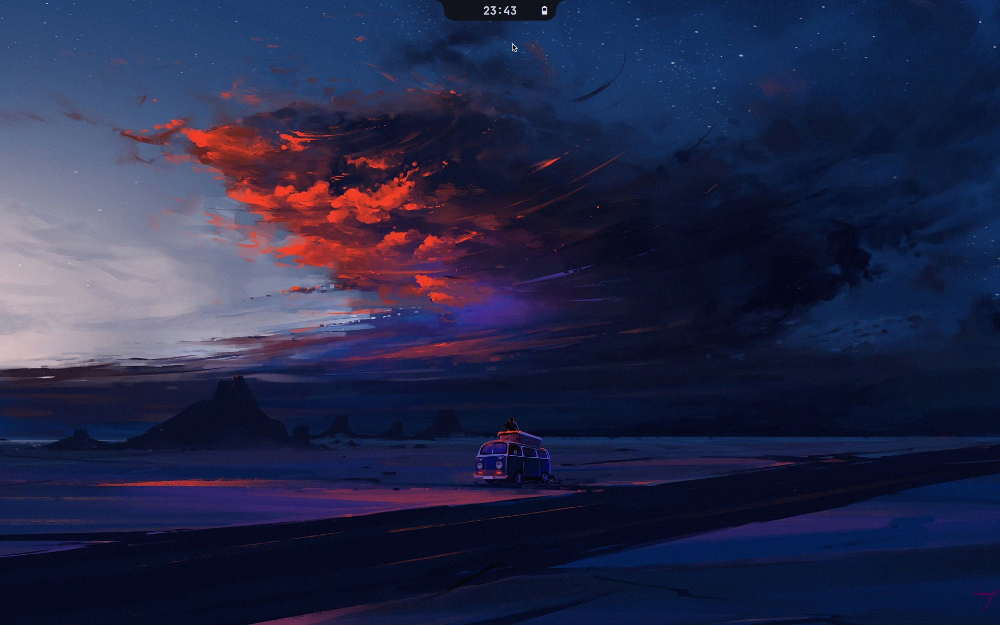
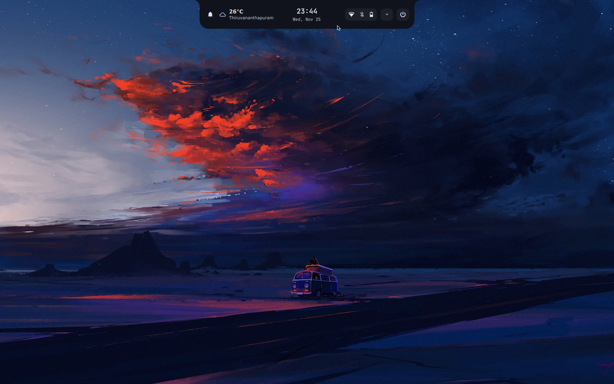
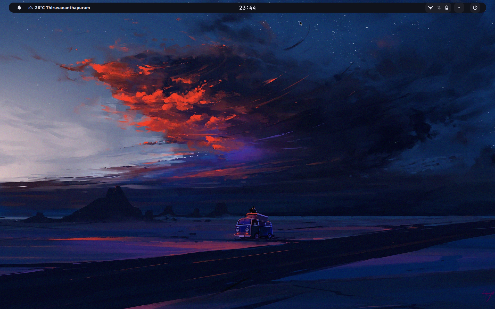
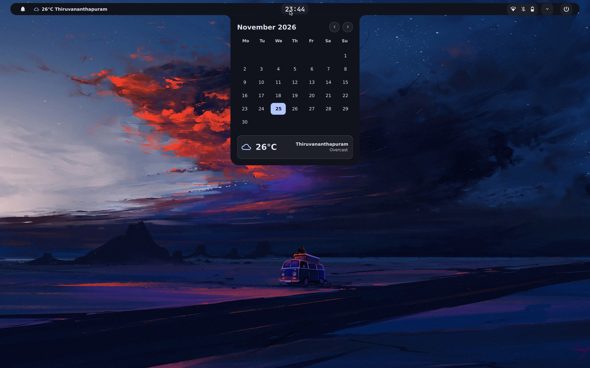
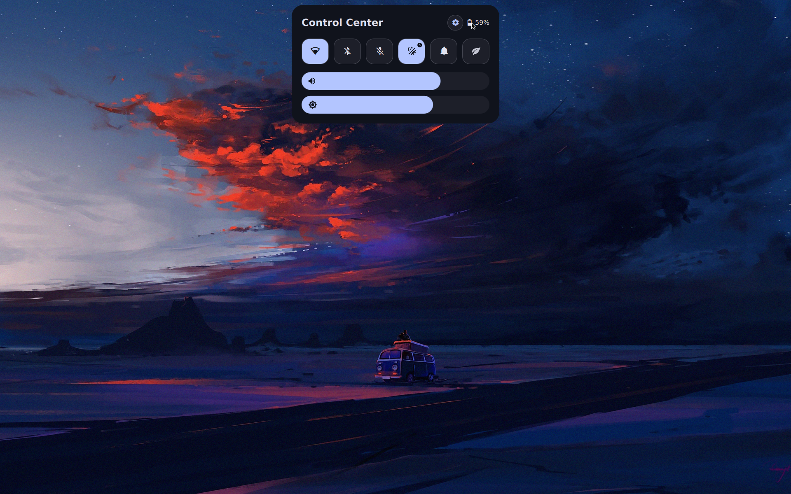
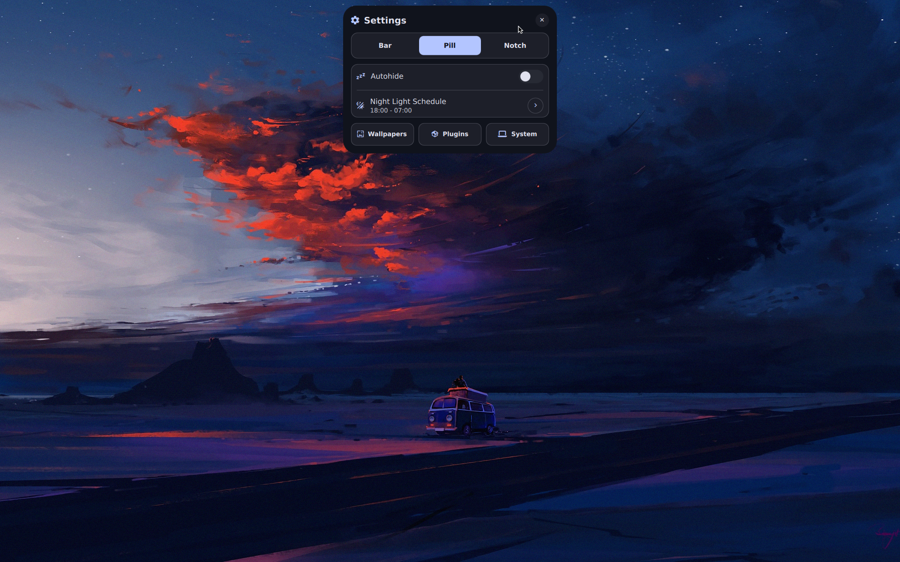
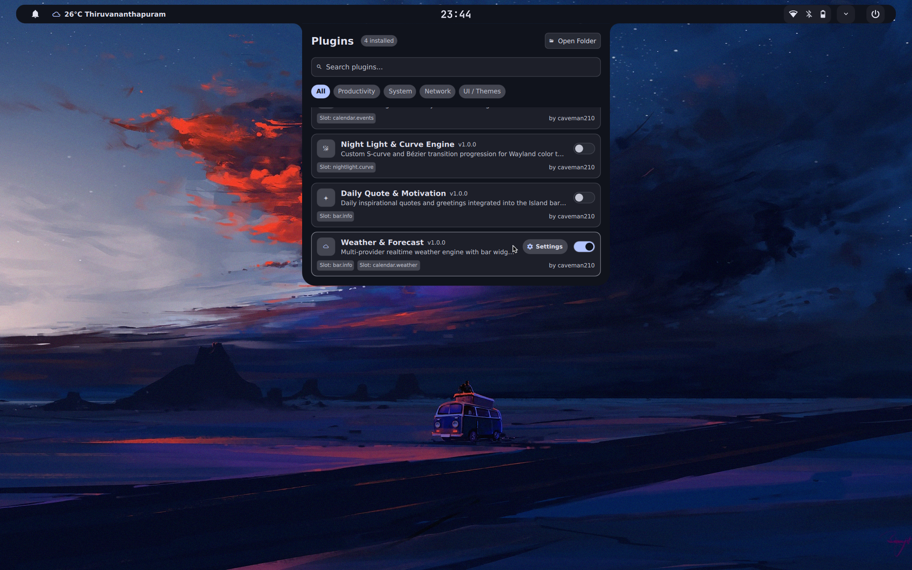

# Flui

**A fluid desktop shell for Hyprland and niri, built with [Quickshell](https://quickshell.org/).**

Flui brings a compact, animated interface to your Wayland session. Choose a small pill, a notch-style island, or a full-width bar, then open contextual panels for media, system controls, notifications, connectivity, and personalization.

The project is built around one shared interface: the island changes shape and reveals the tools you need, when you need them.

> Flui is an actively developed personal desktop project. Its current compositor integrations target Hyprland and niri.

## Screenshots

### Layouts

| Pill (Default) | Pill (Expanded) |
|---|---|
|  |  |

| Notch (Default) | Notch (Expanded) |
|---|---|
|  |  |

| Bar (Default) | Bar (Calendar Dropdown) |
|---|---|
|  |  |

### Panels & Extensibility

| Control Center | Settings |
|---|---|
|  |  |

**Plugins Manager**



## Highlights

### Three layouts

- **Pill** — a compact clock that expands on hover.
- **Notch** — a wider island aligned with the top edge.
- **Bar** — a full-width layout with media, clock, system status, and contextual dropdowns.

The bar and its dropdowns share flow-corner styling, visually joining panels to the screen edges.

### Everyday controls

- MPRIS media controls with track metadata, album art, waveform visualization, and playback progress.
- Control Center for Wi-Fi, Bluetooth, microphone, Focus, Night Light, wallpaper, auto-hide, and layout.
- Battery status, low-battery alerts, volume and brightness feedback, workspace changes, and device notifications.
- Privacy indicators for microphone, camera, and screen-sharing activity.
- Notification history with per-day storage.
- Mounted-storage information and removable-device actions.
- Dedicated power menu.

### Personalization

- Wallpaper selector with temporary preview and automatic rollback.
- Optional wallpaper rotation and transitions through **awww**.
- Wallpaper-derived color extraction and **Matugen** theming.
- Theme selector and optional Hyprland theme synchronization.
- Weather from Open-Meteo, wttr.in, MET Norway, or the aggregator option.
- Night Light scheduling with configurable color temperature (3500K–5500K) and automatic operating hours.
- Vim-inspired navigation in supported selectors and menus.

### Extensibility & Plugins

- **Zero-hotwiring architecture**: Core shell is permanently decoupled from external plugins.
- **Plug-and-play plugins**: Hot-plug extensions into the status bar, Control Center, settings pane, calendar, and notification cards via declarative `ExtensionSlot` components.
- **Autonomous Plugin Backends**: Plugins can provide their own standalone Rust backends (compiled into native binaries), Python scripts, shell scripts, or Node.js runners with independent dependency management.
- **Dedicated Plugins Manager**: Browse installed plugins, toggle them on/off, and configure individual plugin settings inline with dynamic resizing and scrollbars.
- **Generic Plugin IPC**: Inspect and control plugins from outside using `qs ipc call plugins <list|open|toggle|menu|scan>` without hardcoded function names.
- **Strict lifecycle & safety**: When disabled, plugins are 100% inert (zero views, zero bar items, zero background services, settings hidden).
- **System dependency detection**: Missing binaries trigger advisory desktop notifications upon enabling.

## Requirements

Flui is a Linux/Wayland shell built on Quickshell. Current compositor integrations:

- [Hyprland](https://hypr.land/)
- [niri](https://github.com/YaLTeR/niri)

| Dependency | Used for | Notes |
|---|---|---|
| [Quickshell](https://quickshell.org/) | Shell runtime | Required |
| [Cava](https://github.com/karlstav/cava) | Audio visualizer | Required for visualizer |
| [awww](https://github.com/LGFae/awww) | Wallpaper application and transitions | Required for wallpaper changes |
| [Matugen](https://github.com/InioX/matugen) | Wallpaper-derived palettes | Required for dynamic theming |
| ImageMagick | Wallpaper color extraction | Required for palette extraction |
| Python 3 | Weather helper and configuration utilities | Required |
| `wpctl` (WirePlumber) | Volume controls | Required for provided volume helper |
| `brightnessctl` | Brightness controls | Required for provided brightness helper |
| `hyprsunset` | Night Light on Hyprland | Optional |
| `gammastep` | Night Light on niri | Optional |
| `udisksctl` / UDisks2 | Ejecting removable storage | Optional |

Package names vary by distribution. Install the tools through your distribution's package manager.

## Installation

### 1. Install dependencies

Install Quickshell and the utilities for the features you intend to use. Make sure the Quickshell command `qs` is available.

### 2. Get Flui

Back up an existing Quickshell configuration before replacing it:

```bash
mv ~/.config/quickshell ~/.config/quickshell.backup
```

Clone this repository into the standard configuration directory:

```bash
git clone https://github.com/caveman210/Flui.git ~/.config/quickshell
```

### 3. Launch

```bash
qs -c ~/.config/quickshell
```

### 4. Start automatically

#### Hyprland

Add to your Hyprland configuration:

```ini
exec-once = qs -c ~/.config/quickshell
exec-once = awww-daemon

bind = mainMod, P, exec, qs ipc call flui openPowerMenu
bind = mainMod, W, exec, qs ipc call flui openWallpaperSelector
bind = mainMod, T, exec, qs ipc call flui openThemeSelector
```

For Lua-based Hyprland configurations, an example modular configuration is included under `config/hypr/`. Integrate it with your existing setup rather than overwriting it blindly.

#### niri

A ready-made integration block is included:

```kdl
include "~/.config/quickshell/config/niri/flui.kdl"
```

It starts Quickshell and the awww daemon and provides example panel and media-key bindings. You can also copy the relevant entries into your own `config.kdl`.


## Configuration

User settings live in:

```text
~/.config/quickshell/
└── settings.json
```

Flui creates and updates `settings.json` automatically as you change settings in the interface. To pre-configure or inspect the schema, copy the provided template:

```bash
cp ~/.config/quickshell/settings.json.example ~/.config/quickshell/settings.json
```

The configuration controls:

- Weather provider, location, and refresh interval
- Initial layout, bar placement, and information rotation
- Auto-hide and Do Not Disturb
- Wallpaper directory, shuffle interval, and transition
- Matugen and permitted themed applications
- Night Light schedule, target temperature, and transition curve
- First-run state

For most users, the in-app Settings panel is the easiest way to configure Flui. Avoid editing `settings.json` while the shell is running.

### Wallpapers

Flui reads image files directly from the configured wallpaper directory. If no directory is configured, it checks these locations in order:

1. `$XDG_PICTURES_DIR/Wallpapers`
2. `~/Wallpapers`
3. `$XDG_PICTURES_DIR`

Supported formats: JPG, JPEG, PNG, WebP, and GIF. Configure `wallpaperDir` via Settings or in `settings.json` to choose another directory.

The wallpaper backend must be running:

```bash
awww-daemon
```

### Night Light

- **Hyprland:** `hyprsunset`
- **niri:** `gammastep`

Install the matching utility. Core Flui manages binary on/off scheduling and target color temperatures (3500K to 5500K). Advanced transition ramping and custom Bézier easing curves can be enabled via the optional `nightlight-curve` plugin.

## Plugins

Flui features a fully sandboxed, plug-and-play plugin system located at:

```text
~/.config/quickshell/plugins/
├── gcal-sync/         # Google Calendar OAuth sync and live agenda
└── nightlight-curve/  # Wayland gamma curve editor and Bézier progression
```

- Each plugin lives in its own folder with a `plugin.json` manifest.
- Plugins declare slot extensions (`bar.tray`, `controlCenter.cards`, `calendar.events`), background services, and inline settings views.
- Secrets, tokens, and cached files live in `~/.cache/quickshell/<plugin_id>/`.
- Read [docs/PLUGIN_DIRECTIVE.md](docs/PLUGIN_DIRECTIVE.md) for the complete plugin authoring guide.

## Rust Helper (`flui-helper`)

High-performance native utilities are consolidated into a fast Rust binary (`helpers/`):

- `flui-helper plugins`: Manifest discovery, path resolution, and dependency checking.
- `flui-helper weather`: Multi-provider weather fetcher with offline cache fallback.
- `flui-helper sysmon`: CPU, memory, and thermals sampler.
- `flui-helper storage`: Mount point monitor and removable media ejector.
- `flui-helper wallpapers`: Fast wallpaper directory indexer.
- `flui-helper battery`: Power and battery statistics collector.

See [docs/helper.md](docs/helper.md) for the command reference.

### Hyprland theme synchronization

Flui can synchronize selected theme settings with Hyprland. The included example under `config/hypr/` expects a modular configuration; it is not designed to rewrite an arbitrary monolithic `hyprland.conf` or `hyprland.lua`.

On niri, theme selection changes Flui's own appearance. Compositor theme synchronization is currently Hyprland-specific.

## Using Flui

### Layouts

Change the layout in the interface or run:

```bash
qs ipc call flui cycleLayout
```

### IPC commands

Flui exposes an IPC target named `flui`:

| Command | Action |
|---|---|
| `openExpandedHome` | Open the expanded home view |
| `openControlCenter` | Open Control Center |
| `openPowerMenu` | Open the power menu |
| `openWallpaperSelector` | Open wallpaper selector |
| `openThemeSelector` | Open theme selector |
| `openWifiMenu` | Open Wi-Fi menu |
| `openBluetoothMenu` | Open Bluetooth menu |
| `openMedia` | Open media controls |
| `openNotifications` | Open notification history |
| `openPluginsMenu` | Open plugins manager |
| `cycleLayout` | Cycle Pill → Notch → Bar |
| `focusToggle` | Toggle Focus |
| `reset` | Return to the idle island |

Example:

```bash
qs ipc call flui openPowerMenu
```

See [docs/IPC.md](docs/IPC.md) for the IPC reference and compositor binding examples.

### Interaction and keyboard navigation

- In Pill and Notch layouts, hover over the island to expand it.
- Click an empty area of the expanded island to pin or unpin it.
- In Bar layout, the clock and status sections open their own dropdowns.
- Open media controls from the media section.

## Nix and Home Manager

The repository provides a Nix flake with package outputs for `x86_64-linux` and `aarch64-linux`, plus a Home Manager module.

The module exposes:

- `programs.flui.enable`
- `programs.flui.package`
- `programs.flui.systemd.enable`

The optional systemd user service starts Flui with `graphical-session.target`. Refer to [flake.nix](flake.nix) and [package.nix](package.nix) for the current packaging implementation.

## Project structure

```text
shell.qml       Quickshell entry point
core/           Shared state, controllers, and status management
island/         Island state, interaction, and view hosting
services/       System data providers, compositor integrations, and PluginService
windows/        Layer-shell windows and edge trigger
views/          Pill, Notch, Bar, and panel interfaces (including PluginsMenuView)
components/     Reusable interface components and ExtensionSlot
plugins/        Hot-pluggable self-contained plugins
helpers/        Rust helper binary (flui-helper) for fast background sampling
styles/         Shared style constants and theme definitions (Theme.qml)
config/         Settings store and compositor examples
scripts/        Lightweight system scripts
assets/         Icons and supporting assets
docs/           Architecture notes, IPC reference, and Plugin Directive
```

Read [docs/ARCHITECTURE.md](docs/ARCHITECTURE.md) for module responsibilities and development conventions.

## Troubleshooting

- **Nothing appears:** launch with `qs -c ~/.config/quickshell` from a terminal and inspect output for QML errors or missing commands.
- **Wallpaper selection does not apply:** check that `awww-daemon` is running and that the configured directory contains supported image files.
- **Volume feedback is missing:** bind the provided `scripts/volume.sh` helper; it changes volume and writes the event used by Flui's status notification.
- **Brightness feedback is missing:** bind `scripts/brightness.sh` and check that `brightnessctl` can control your display.
- **Night Light is unavailable:** install `hyprsunset` on Hyprland or `gammastep` on niri.
- **Hyprland theme does not change:** check the modular example integration and whether the selected theme includes a Hyprland theme file.

## Credits

Flui builds on the work and ideas of the Quickshell ecosystem and projects exploring Dynamic Island desktop interactions, including [Luci](https://github.com/ElhamSadiqi/Luci), [ChillPill-Shell](https://github.com/LUCKYS1NGHH/ChillPill-Shell), and [islandcn](https://github.com/opencoredev/islandcn).

Flui's implementation, integrations, and ongoing development are maintained in this repository.

## License

Flui is licensed under the [MIT License](LICENSE).
